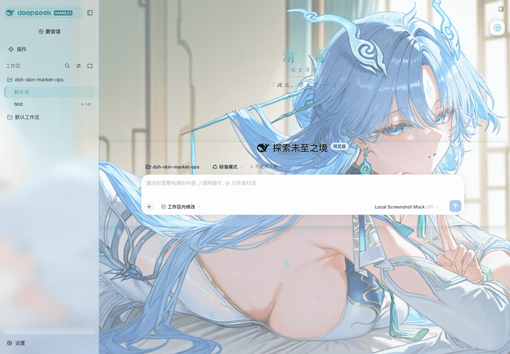
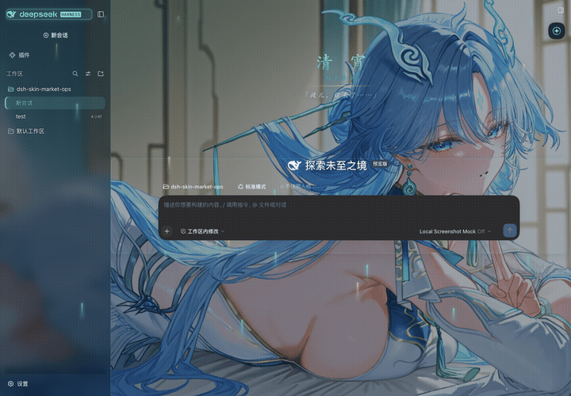

# 清宵 · 弦凝清霄 — DSH 美化包

以《鸣潮》角色**清宵**（3.6 版本登场的五星气动·迅刀共鸣者，瑝珑「镇玄司骑」，琴剑双修的隐世剑仙）为主题的 DeepSeek Harness (DSH) Web 界面皮肤。

> 「弦凝千古寂，剑起满天清」

配色调色板取自清宵的形象：**冰蓝**（发色）、**青碧**（发饰流苏）、**月白**（衣装）、**玄夜蓝**（暗色形态）、**鎏金**（金饰点缀）。





## 这个皮肤有什么

- **背景画卷**：默认铺一张清宵插画当背景，亮色、暗色模式都能透出它。可以在设置面板里分别为两种模式换成你自己的图（PNG / JPG / WebP / GIF，10MB 以内；可点选，也可直接把图拖到按钮上），也能一键换回默认。面板会标注当前是亮/暗形态。
- **全套配色重制**：侧边栏、按钮、输入框、对话区、代码块、滚动条……界面每一处都按清宵的配色重新调过；暗色模式是专门的「玄夜剑鸣」氛围。
- **开屏动画**：每次打开 DSH，AI 白描线稿会在夜幕上沿噪声场平滑显影，完整线稿定格片刻让你看清细节，一道剑光闪过翻成素描纸底，彩色画卷再带饱和度爬升浮现，最后淡出交给正常界面。按 Esc 或点击可跳过；系统开了「减少动态效果」自动不播；不想要可以在调色盘里关掉。
- **毛玻璃效果**：打开插件的小窗口（比如用量统计）、左右两侧面板、插件页/自动化任务页等整页视图、设置弹窗乃至窗口顶栏，背后的画面都会被柔和地虚化掉——壁纸的轮廓透得出来，但绝不跟文字打架。想多糊可以多糊（0–30 档随意调），不想要可以整体关掉，也可以只关插件窗或只关侧栏。
- **液态玻璃输入框**：输入框默认带从左到右扫过的流光、四角流动光斑、跟随光标的小范围高光、旋转的青碧/鎏金描边、呼吸光晕与毛玻璃折射，亮/暗各自配色；输入文字、占位符和工具行都提高了对比度，统计行仍在框外。全部动画走 `transform` / `opacity` 合成层，玻璃底静态绘制，长时间输入与滚动也不掉帧。鼠标光晕可单独关闭，也可在「界面 → 输入框质感」一键切回 DSH 原版输入框。
- **字永远看得清**：文字颜色专门为「压在插画背景上」调校过——正文浓黑/亮白，次要文字也比 DSH 原生的灰色深两档；背景还有可调浓度的柔光遮罩兜底。
- **个性化定制**：正文字体、代码字体、行高、字距都能自己调；提供 6 套色板与强调色取色器，强调色自动校正到可读对比度，并随 `.qx-theme.json` 主题包一起导出分享。
- **主题中心**：清昼 / 玄夜 / 剑鸣 / 雪霁 四套预设；主题可导出为 `.qx-theme.json` 或主题码，也能导入别人的主题，不会覆盖你的画卷。
- **视频壁纸**：亮/暗形态可分别放一段本地 MP4 / WebM（≤64MB）或远程视频 URL，自动截首帧当封面；支持静音循环、低功耗暂停与兼容播放。
- **剑气流光**：可选的粒子装饰，青碧或鎏金两种色调；系统开了「减少动态效果」会自动静止。
- **亮暗切换动画**：切换主题时有一抹剑光扫过屏幕的小动画，浏览器标签栏颜色和图标也会跟着换。
- **新会话迎宾页**：打开空会话时，屏幕中央浮现「清 宵 · 镇玄司骑 · 徒儿，你来了……」的题字，开始对话后自动退场。
- **人格（可选）**：让 DSH 以清宵、或你自定义的任意角色对话。设置页「人格」里有内置清宵与人格库，可新建 / 导入 / 编辑 / 切换；开新会话时输入区「标准模式」右侧还有一个人格键，直接选本会话用谁（含「不使用人格」）。
- **默认深色**：首次安装会把 DSH 的主题偏好设为深色，并在调色盘/设置页顶部提示「建议搭配深色模式使用」；面板磨砂玻璃默认开启。
- **设置跟着账号走**：所有偏好保存在 DSH 的数据目录里，换个浏览器、重启电脑都还在。

## 设置面板

点界面右上角的**清宵剑钰圆形按钮**打开调色盘。按钮可以拖到任意位置，位置会记住；面板底部有「回位」一键复位，以及两步确认的「恢复默认」。

面板改成五个标签页，设置页内嵌的是同一套界面，宽屏下自动排成双列卡片；顶部会提示「建议搭配深色模式使用」，面板磨砂玻璃默认开启。

| 标签 | 能调什么 |
| --- | --- |
| 主题 | 清昼 / 玄夜 / 剑鸣 / 雪霁 四套预设 · 导出/导入主题文件 · 主题码入口 |
| 阅读 | 文字对比增强 · 背景遮罩 · 面板不透明 · 正文字号 · 正文字体/代码字体 · 行高 · 字距 · 6 套色板与强调色 |
| 界面 | 对话区宽度 · 面板磨砂玻璃（默认开） · 液态玻璃输入框（可切回原版） · 鼠标光晕跟随 · 毛玻璃虚化 · 开屏动画与流光 |
| 画卷 | 亮/暗画卷与 URL · 填充与焦点 · URL 轮播 · 本地视频与播放策略 |
| 高级 | 远程视频 URL · 主题码 · 跳转人格设置 · 只读体检 |
| 恢复默认 | 吸底页脚，两步确认；不会删除已上传的媒体文件 |

## 人格（可选）

在 DSH 设置页左栏点「人格」，可让 DSH 以指定角色的语气、称呼与剧情边界持续对话。

- **人格库**：内置《鸣潮》清宵，也可新建或导入自己的 soul.md / style.md。「使用」即设为当前人格；「查看」只读预览；「编辑」可改名称、直接编辑 soul/style，或整篇导入替换。编辑内置清宵会自动生成一份副本，不会改动内置资源。
- **注入位置**：人格指令写入 `~/.dsh/AGENTS.md`（DSH 用户全局指令，哨兵注释包裹，关掉或卸载即自动移除），**只影响新会话**。
- **新会话人格键**：开新会话时，输入区「标准模式」右侧有「人格」键，直接选本会话用谁，含「不使用人格」。会话一旦开始，该键随欢迎页消失——**选定后请勿中途更换，要换人格请开新会话**。
- **注入选项**：剧透闸门、对使用者的称呼、OOC 触发词、身份锚与 soul/style 核心区开关、注入预览。
- **定制任意角色**：推荐配合 [character-persona-forge](https://www.npmjs.com/package/character-persona-forge) 使用——从官方文本与配音考据出发，为任意角色生成 soul.md / style.md / sources.md。

## 版本

当前版本 **0.7.2**（2026-11-14）。各版本改动见 [CHANGELOG.md](CHANGELOG.md)。

## 安装

### 懒人版

直接对你的 DSH 说（桌面端、网页端都适用，会装进当前档案）：
```
安装一下这个皮肤包：@taosee258/dsh-client-ui-skin-qingxiao
```

### 手动安装

**命令行安装**（任选其一；`--profile` 按目标填：桌面端 `desktop`、网页端 `web`）：

```sh
# 方式 A（推荐）：从 npm 安装
dsh plugin --profile desktop add @taosee258/dsh-client-ui-skin-qingxiao
```

```sh
# 方式 B：用 git URL 安装（始终对应仓库最新版）
dsh plugin --profile desktop add https://github.com/taoser258/dsh-client-ui-skin-qingxiao
```

```sh
# 方式 C：先克隆到本地任意位置，再把实际路径交给 dsh
git clone https://github.com/taoser258/dsh-client-ui-skin-qingxiao.git
dsh plugin --profile desktop add /path/to/dsh-client-ui-skin-qingxiao
```

**手动放置安装**：把本包整个文件夹复制到 DSH 的 `profiles/<档案名>/node_modules/@taosee258/dsh-client-ui-skin-qingxiao/` 下（桌面端档案为 `desktop`），然后在 profile 的 `cordis.patch.yml` 里追加一条（与本包自带的 `cordis.patch.yml` 保持一致）：

```yaml
- insert:
    - id: ui-skin-qingxiao
      name: '@taosee258/dsh-client-ui-skin-qingxiao'
```

重启 DSH 即可。

## 兼容性

- DSH Web / 桌面端：0.1.0-rc.6 至 0.2.2-rc.3
- 自 0.2.0 起针对官方桌面端深度适配：字号令牌新基准、顶栏毛玻璃横带与原生窗口按钮融合、插件/任务等整页视图毛玻璃背板、开关与徽章配色对齐；0.2.1 起代码字号跟随官方「代码字号」设置
- 0.2.2 起 `@deepseek-ai/dsh-client-runtime` 已从宿主移除，slots / primitives / dockkit 为平台共享模块；本版已对齐（移除旧依赖，并用 `data-slot` / DockKit 钩子替换 `data-pane` / `detailsCol`）
- 0.2.2-rc.2 / rc.3（2026-11-13）新增的会话头部视图标签、侧栏「更多」收纳、通知与悬浮卡、审阅改动页、子代理/团队面板与 macOS 侧栏玻璃，沿用同一套 `data-slot` / `data-dockkit-*` 钩子；本版补齐了这些新界面使用的 `--dsw-alias-card-fill`、`--dsw-alias-hovercard-*`、`--dsw-specific-sidebar-glass-*`、`--dsw-alias-trajectory-accent` 等令牌映射，避免新卡片露出宿主中性灰底
- 平台：Web / Windows 桌面端（设置与人格数据保存在各自档案的 `data/` 目录下）
- 最近验证：2026-11-14（客户端回归 102/102：五标签与设置页嵌入、字体/配色/布局持久化、主题包与主题码、暗色重建、液态输入框/光标光晕开关与跟手层、流光描边独立层、按钮冒烟与死按键检查、浅色题字裁剪、rc.3 新令牌覆盖；服务端 52/52。另用 rc.3 的 npm 包在独立 Web 档案真实启动 Harness 复核：皮肤加载、调色盘五标签、液态输入框、深浅色与新侧栏入口均正常。桌面端 rc.3 真机复核待宿主更新后进行）

## 版权所有人

| 版权所有人 | 版权所有内容 |
|---|---|
| Kuro Games（库洛游戏） | 「鸣潮」游戏作品及清宵（Qingxiao）角色形象原作 |
| Fumi（pixiv） | 默认背景插画（`assets/qx.jpg`）原作 |
| taoser | 皮肤实现（配色、毛玻璃、粒子装饰与界面逻辑） |

\*本皮肤为同人创作，与 Kuro Games 无关联。

## 署名与许可

- 默认背景插画来自 **pixiv 画师 Fumi** 的《鸣潮》清宵同人插画（`assets/qx.jpg`），角色设定与游戏内容版权归库洛游戏所有。本皮肤仅供个人美化学习使用，与官方无关，请勿商用。
- 插件代码与结构在 CC BY-NC-SA 4.0 下发布，请勿用于商业用途。
